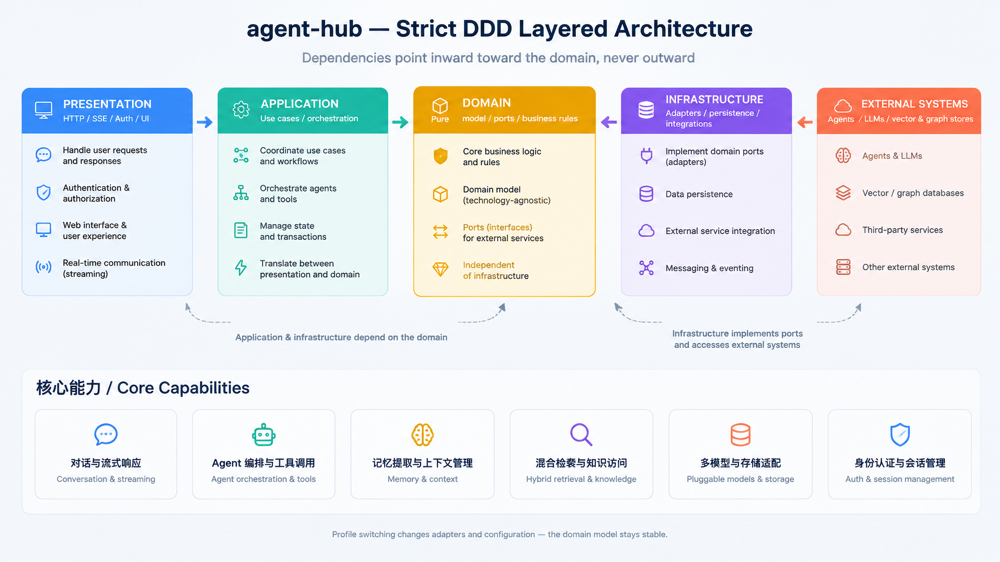
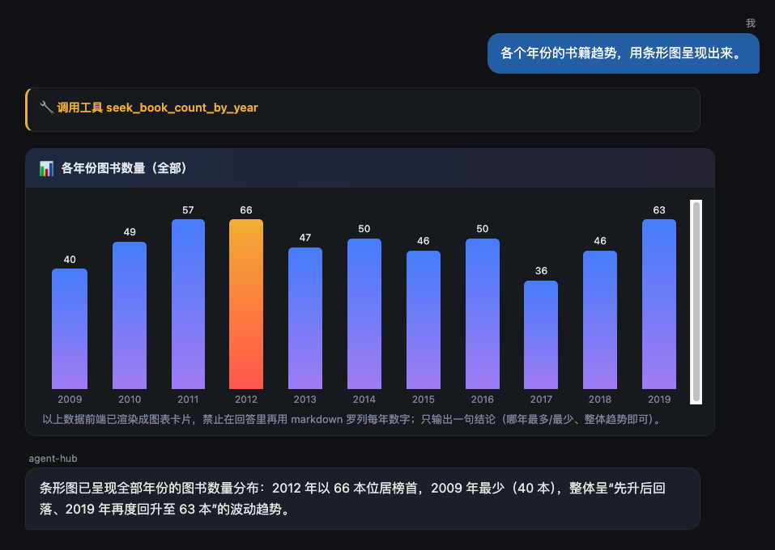
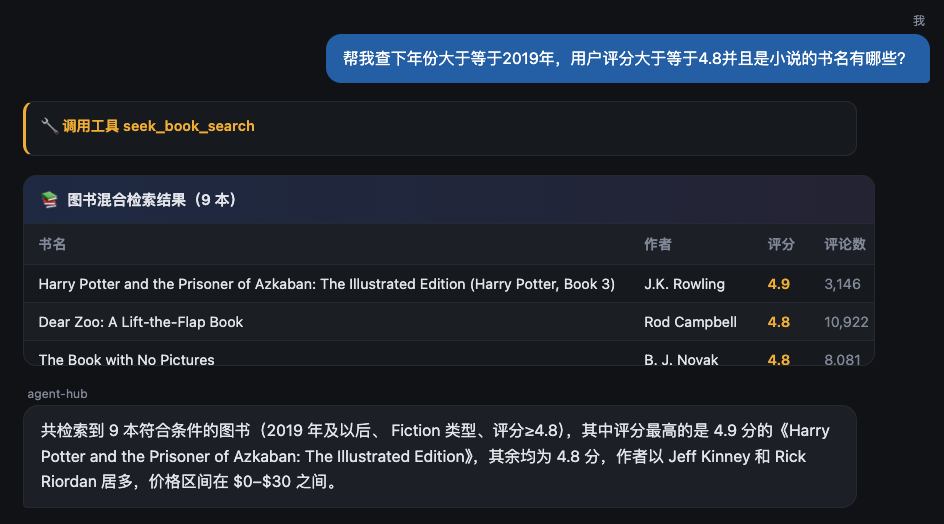
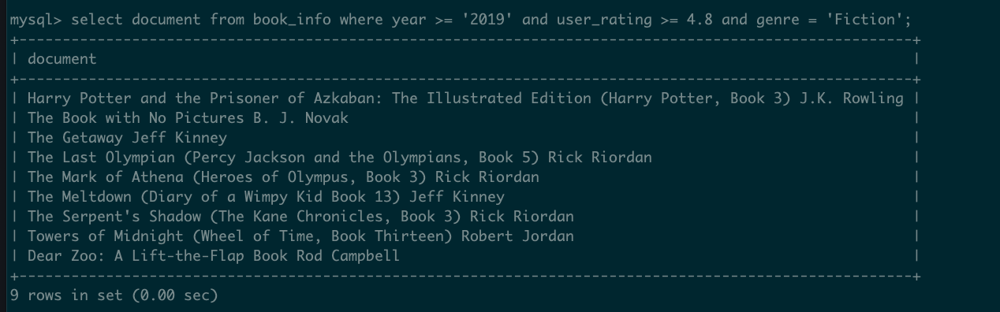

# agent-hub

> A conversational data-analysis agent built on **AgentScope Java 2.0 + Spring Boot WebFlux + SeekDB**, demonstrating a clean DDD-layered architecture, ReAct agent orchestration, **A2UI** structured result cards, and hybrid (vector + full-text + scalar) retrieval.

🇨🇳 中文文档 / Chinese documentation: [README.zh-CN.md](README.zh-CN.md)

## Features

- **ReAct orchestration** via AgentScope 2.0 `ReActAgent`, driven by a single Hunyuan (`hy4`) LLM through Tencent LKEAP's Anthropic-compatible gateway.
- **A2UI (Agent-to-UI)**: tools return structured JSON (`type: hybrid | chart | table`) instead of markdown; the frontend renders native cards (bar/pie charts, hybrid-retrieval panels), and the prompt forbids the LLM from re-listing results as text.
- **Hybrid retrieval**: vector (local hashing embedder) + full-text + scalar filtering, fused with Reciprocal Rank Fusion (RRF) for book search; vector nearest-neighbor for conversation memory.
- **Dual memory**: short-term (in-session history) + long-term (an async `MemoryExtractor` distills stable facts, stored and semantically recalled across sessions).
- **Pluggable industry persona**: switch domains (e-commerce analytics / OceanBase knowledge graph) by swapping the `AgentPersona` only.
- **Multi-profile Spring config**: `seekdb` (default), `mongo`, `oceanbase`.
- **Auth**: phone+OTP and WeChat QR login; sessions held in MongoDB, enforced by a WebFilter.

## Architecture

The codebase follows strict **DDD layering** (dependency points inward, never outward):



The layered diagram above is generated from the actual package layout — `presentation → application → domain ← infrastructure`, with external systems reached only by infrastructure adapters.

### ReAct event stream

`ReActAgent` emits 31 typed events; `AgentEventMapper` collapses them into 5 domain events pushed to the browser over SSE:

`Thinking` → `ToolCalling(toolName, args)` → `ToolResult(toolName, result)` → `Token` (streamed answer) → `Completed`

### Tools (seekdb profile)

| Tool | Purpose |
|------|---------|
| `seek_sql_query` | Run SELECT on SeekDB; 2-column aggregate results auto-render as a bar chart (A2UI `type: chart`). |
| `seek_hybrid_search` | Semantic hybrid search over conversation/knowledge-base history. |
| `seek_book_search` | Book hybrid retrieval (vector + full-text + scalar); returns A2UI `type: hybrid` card. |
| `seek_book_count_by_year` | Year-grouped book counts as a bar/pie chart (`type: chart`). |
| `seek_fork_sandbox` | Fork a COW sandbox DB for experimental writes. |
| `save_memory` | Persist a stable fact to long-term memory. |

### A2UI (Agent-to-UI)

Instead of dumping tool output as markdown prose, every tool returns a **typed JSON envelope** carrying a `type` field. The browser mounts the envelope as a native card rather than re-parsing text, so results stay structured and the LLM is explicitly instructed not to re-list them in plain text.

Supported card types:

| `type`   | Rendered as | Produced by |
|----------|-------------|-------------|
| `chart`  | Bar / pie chart (pure CSS) | `seek_sql_query` (2-column aggregates), `seek_book_count_by_year` |
| `hybrid` | Mixed retrieval panel (vector + full-text + scalar hits) | `seek_book_search`, `seek_hybrid_search` |
| `table`  | Markdown / HTML table | scalar query results |

The frontend (`src/main/resources/static/chat.html`) detects an envelope via `isUiJson()` and mounts it with `addUiBlock()`. **No charting library is used** — bar charts are `div` heights, pie charts are CSS `conic-gradient`, fully self-contained.



### Hybrid retrieval

Retrieval fuses three signals and ranks them together:

- **Vector** — a local hashing `LocalEmbedder` produces embeddings; nearest neighbours recalled by L2 distance.
- **Full-text** — `LIKE` / `$contains` matching on the document text (book name + author).
- **Scalar** — structured filters on `year`, `genre`, `price`, `user_rating`, `reviews`.

Book search fuses vector + full-text + scalar with **Reciprocal Rank Fusion (RRF)**; conversation memory uses vector nearest-neighbour recall. The pipeline is offline-friendly: embeddings are computed at import time (`BookDataImporter`), so no external vector service is required at query time. (Design detail: [`doc/hybrid-search-architecture.html`](doc/hybrid-search-architecture.html).)

The chat UI rendering a hybrid-retrieval card:



The underlying data model (book metadata + precomputed vector embeddings) in SeekDB:



## Tech Stack

- Java 21, Spring Boot 3.3.4 (WebFlux, reactive)
- AgentScope Java 2.0.3 (`io.agentscope`)
- OceanBase / SeekDB JDBC, MongoDB reactive driver, Neo4j Java driver
- Reactor (projectreactor)
- Frontend: vanilla HTML/CSS/JS (no framework)

## Prerequisites

- JDK 21
- Maven 3.9+
- Docker + Docker Compose (for SeekDB, MongoDB, Neo4j)

## Getting Started

### 1. Start infrastructure

```bash
docker-compose up -d
```

This brings up SeekDB (`:2881`), MongoDB (`:27017`), and Neo4j (`:7687`), and runs the init SQL under `plugins/seekdb-init/`.

### 2. Configure the model key

The LLM API key is **never** stored in the repo. Export it as an environment variable:

```bash
export AGENT_MODEL_API_KEY=sk-xxxxxxxxxxxxxxxx
```

(See `.env.example` for the full list.)

### 3. Build

```bash
mvn clean package -DskipTests
```

### 4. Run

```bash
java -jar target/agent-hub-1.0.0.jar
# or, during development:
mvn spring-boot:run
```

### 5. Open the UI

Visit `http://localhost:8080/chat.html` (sign in via OTP or WeChat QR first).

### Profiles

| Profile | Description |
|---------|-------------|
| `seekdb` (default) | E-commerce analytics over SeekDB + MongoDB. |
| `mongo`  | Same app, MongoDB as the primary repository. |
| `oceanbase` | Neo4j-backed OceanBase knowledge-graph Q&A. |

```bash
java -jar target/agent-hub-1.0.0.jar --spring.profiles.active=oceanbase
```

## Configuration

| Variable | Required | Default | Description |
|----------|----------|---------|-------------|
| `AGENT_MODEL_API_KEY` | ✅ | — | Hunyuan/LKEAP API key. |
| `AGENT_MODEL_BASE_URL` | ❌ | `https://api.lkeap.cloud.tencent.com/plan/anthropic` | Anthropic-compatible gateway. |
| `AGENT_MODEL_NAME` | ❌ | `hy4-preview` | Model name. |
| `NEO4J_URI` | ❌ (oceanbase) | `bolt://localhost:7687` | Neo4j bolt URI. |
| `NEO4J_USER` | ❌ | `neo4j` | Neo4j user. |
| `NEO4J_PASSWORD` | ❌ | `oceanbase123` | Neo4j password (local demo). |
| `SEEKDB_PASSWORD` | ❌ | (empty) | SeekDB/OceanBase JDBC password. |

## Project Structure

```
agent-hub/
├── src/main/java/com/riemann/agent/
│   ├── presentation/   # HTTP/SSE controllers, auth, static UI
│   ├── application/    # use cases: ConversationAppService, MemoryExtractor, AgentEventMapper
│   ├── domain/         # model + ports: Conversation, Message, AgentEvent, AgentPersona, *Repository
│   └── infrastructure/ # adapters: AgentToolkit (@Tool), SeekDb repos, HybridSearch, LocalEmbedder, config
├── src/main/resources/ # application.yml, static/chat.html (A2UI renderer)
├── plugins/            # pluggable components
│   ├── seekdb-init/    # SeekDB init SQL (docker-mounted to /init)
│   ├── neo4j/          # Neo4j (OceanBase KG) local launcher
│   └── oceanbase-kg/   # (sub-project) Python crawler + knowledge-graph builder
├── doc/                # architecture diagram (architecture.png) & design docs
├── sql/                # seed data & SQL scripts (bestsellers_with_categories.csv, schema-seekdb.sql, seed-ecommerce.sql)
├── docker-compose.yml  # SeekDB + MongoDB + Neo4j
└── pom.xml
```

## Sub-projects

- **`plugins/oceanbase-kg/`** — Python tooling that crawls OceanBase docs/code/community and builds the Neo4j knowledge graph. See its own `requirements.txt` / `.env.example`.

## License

[Apache License 2.0](LICENSE).
